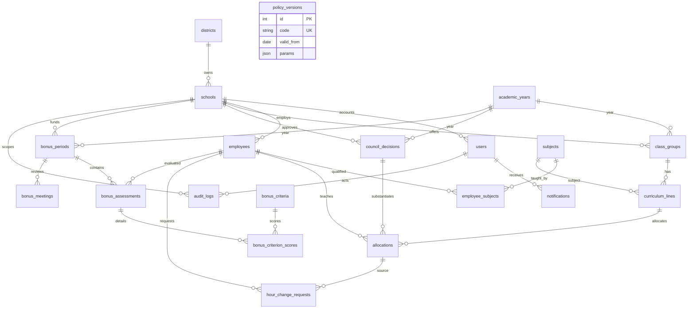

# EduTarif — database skeleton and migration operator guide

> **Source of truth:** `app/models.py` SQLAlchemy metadata +
> `migrations/versions/20261119_01_baseline_schema_20_tables.py`. 20 existing tables;
> the drawing is a relational overview, **not** a claim of legal compliance.

[ER diagram preview](mockups/schema_overview.jpg) · Editable layout: [`docs/schema_erd.dot`](schema_erd.dot).

## Current relation diagram (20 tables)



### Modules and table inventory

| Subsystem | Current tables | Future additions (NOT YET implemented) |
|---|---|---|
| District / identity | `districts`, `schools`, `users`, `audit_logs`, `notifications` | session revocations, scoped permission grants |
| School / curriculum | `academic_years`, `subjects`, `class_groups`, `curriculum_lines`, `council_decisions` | validated curriculum source / grade-language template / group evidence |
| Staff / workload | `employees`, `employee_subjects`, `allocations`, `hour_change_requests` | employment contracts, credentials, allocation history revisions |
| 823 / funds | `bonus_periods`, `bonus_assessments`, `bonus_criteria`, `bonus_criterion_scores`, `bonus_meetings` | individual committee membership, conflicts, signed order |
| Normative source | `policy_versions` | date-effective rules/exception review, documented approval |

**Separation:** `school_id` in queries is a mandatory access-control boundary, and `year_id` is a mandatory business boundary where relevant; foreign keys alone do not enforce tenant segregation. Materialized 1–4 and 5–11 academic workloads must be evaluated separately after authoritative curriculum imports.

## Safe setup on a NEW EMPTY database

```bash
pip install -r requirements.txt
cp .env.example .env
# Set SESSION_SECRET / DATABASE_URL and other secrets in .env
alembic upgrade head
alembic current
python -m scripts.bootstrap_admin
```

`bootstrap_admin` ensures minimal district record and admin, NOT the official hour grid. For local sample subjects/year only, optionally execute `python -m scripts.init_db` (development only).

## Existing pre-migration installations

The initial migration **intentionally refuses to run when any user-created tables already exist** and never uses `create_all()` to alter production schemas. Do not delete the database to make it pass.

1. Schedule a maintenance window; make an independently verified backup, tested restore, and record application version.
2. Run `python -m scripts.schema_report`, review all table/column/type/nullability/FK/index differences with a database engineer.
3. Resolve the differences with *reviewed*, non-destructive migrations if any differ; do not stamp incomplete schemas.
4. Only for a **verified exact baseline**, mark the existing schema `alembic stamp 20261119_01` and then `alembic current`.
5. Run `alembic check`, smoke tests and record evidence in deployment change log.

`alembic stamp` marks schema version **without modifying tables**; it does not check parity or fix a schema. `alembic downgrade base` drops all application tables and must **only** be used on a disposable empty-data test DB.

## Tests

SQLite: `pytest -q tests/test_migrations.py` (creates disposable tmp database, upgrade, re-upgrade, schema check, downgrade, legacy refuse test).

PostgreSQL: execute on **dedicated disposable DB only** after DB engineer verification. No PostgreSQL instance was available during the initial migration implementation; no PostgreSQL success is claimed.

## UX mockups

`docs/UI_WIREFRAMES.md` gives display requirements; synthesized image previews are conceptual and show synthetic KPI counts, not measured school/bonus compliance.
